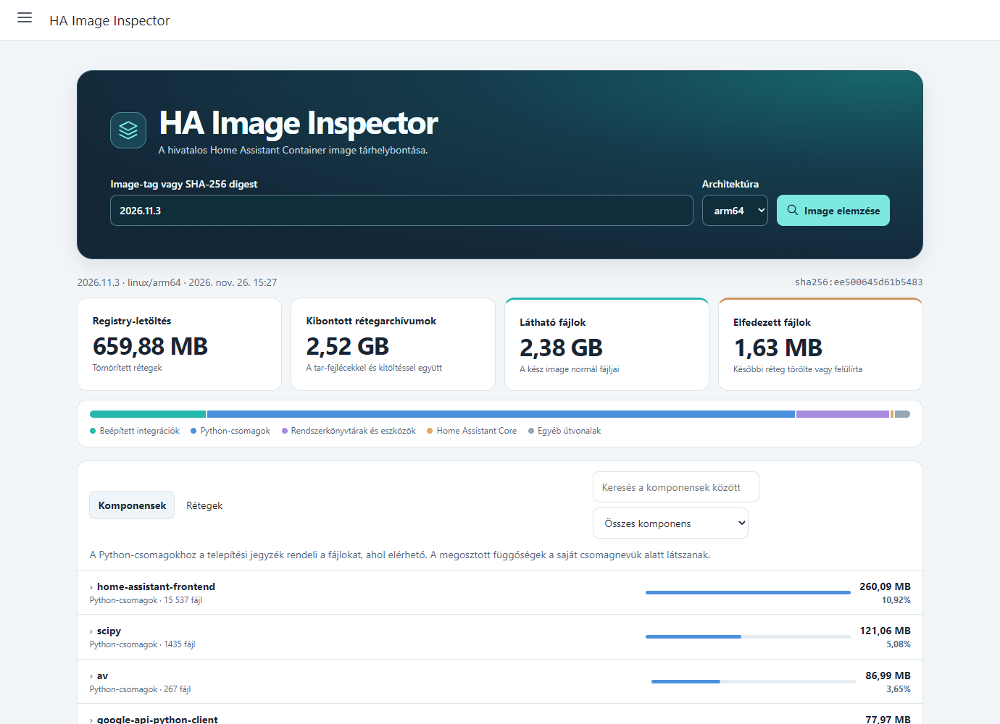

# HA Image Inspector

[Magyar leírás](README.hu.md)

HA Image Inspector adds an administrator-only sidebar panel for the official Home Assistant Container image. Find the biggest built-in integrations, Python packages and system libraries, see the largest files in each group, or inspect individual build layers.



## Install with HACS

1. In HACS, open **Custom repositories** and add `https://github.com/kbalint/ha_image_inspector` as an **Integration**.
2. Download **HA Image Inspector** and restart Home Assistant.
3. In **Settings → Devices & services → Add integration**, select **HA Image Inspector**.
4. Open **HA Image Inspector** in the sidebar and select **Analyze image**.

For manual installation, copy `custom_components/ha_image_inspector` from the release into your Home Assistant configuration directory under `custom_components`, then continue from Step 2. Home Assistant 2026.11 or later and outbound HTTPS to GHCR and its blob storage are required.

## Choose an image

The default is the running Home Assistant Core version and its CPU architecture. You can enter any published tag from `ghcr.io/home-assistant/home-assistant`, or paste a `sha256:…` manifest digest for an immutable selection. To confirm the digest of your container's local image, run these commands on the Docker host, replacing `homeassistant` with your container name:

```sh
image_id=$(docker container inspect --format '{{.Image}}' homeassistant)
docker image inspect --format '{{range .RepoDigests}}{{println .}}{{end}}' "$image_id"
```

Use the digest after `@` from the official repository entry. Locally built and private images are outside the integration's scope. A scan streams every compressed layer, so it can transfer several hundred megabytes. The most recent successful report is saved in Home Assistant. The integration uses outbound registry requests and has no Docker socket dependency.

## Read the totals

| Metric | What it measures |
| --- | --- |
| Registry download | Compressed layer blobs for the selected platform |
| Unpacked layer archives | Uncompressed tar streams including headers and padding |
| Visible files | Regular-file contents in the final image, counting hard-linked content once |
| Hidden file payload | File contents still stored in lower layers after removal or replacement |

The measurements cover image layers. Container writes, `/config`, external volumes, shared-layer deduplication and storage-driver overhead are outside their scope. Sizes are decimal. Python files are attributed using installation records where available. The detail view links direct requirements declared by built-in integrations to packages present in the image. Shared and transitive dependencies keep their own byte totals.

The Home Assistant 2026.11.3 ARM64 scan found **2.38 GB** of visible file contents across **2.52 GB** of unpacked layer archives, with **660 MB** of compressed layer data. Its largest build layer installs Python wheels and integration requirements.
